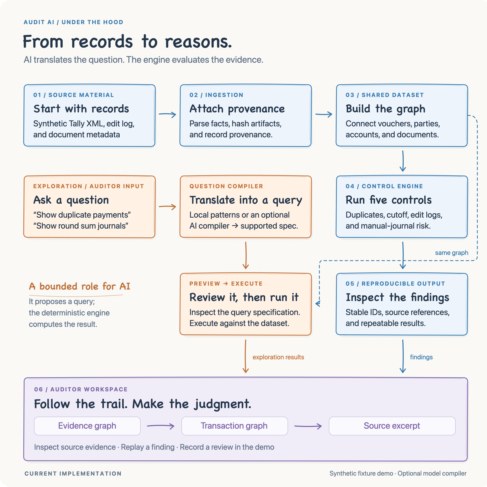

<div align="center">

# Audit AI

### Follow every finding back to the evidence.

An evidence-first financial audit workspace.

Deterministic audit controls · Traceable transaction graphs · AI-assisted exploration

[Quick start](#quick-start) · [Demo walkthrough](#demo-walkthrough) · [Architecture](#how-it-works) · [Development](#development)

</div>

---

Audit AI helps Chartered Accountants and audit teams investigate financial records, understand why a transaction was flagged, and inspect the source behind a finding. It brings rules, transactions, supporting documents, and review decisions into one connected workspace.

The core idea is simple: **AI translates the question; deterministic code evaluates the evidence.** Every implemented control produces reproducible findings with source references. The workspace lets you move from a finding to its transactions and down to the underlying source excerpt.

## What you can do

- **Run five audit controls** against a complete synthetic engagement, covering edit-log integrity, duplicate payments, year-end cutoff, and manual journals.
- **Explore three connected layers:** the evidence graph, the transaction graph, and source documents.
- **Inspect provenance:** connect graph facts to artifact hashes, parser metadata, and source locations.
- **Replay a finding** by rerunning the controls and checking that its identifier reproduces.
- **Review exceptions** with a reason and materiality assessment in the demo workspace.
- **Ask focused questions** using a local compiler or an optional model-backed compiler, inspect the generated query specification, then execute it.
- **Browse an India audit rule pack** containing 15 definitions: five implemented controls and ten specifications for future connectors.

## Quick start

Use **Bun 1.3.14 or newer** with Node.js available for the Next.js application. The project includes a Bun lockfile, and its scripts use Bun throughout.

```bash
git clone https://github.com/whyharsh/Audit-AI.git
cd Audit-AI
bun install --frozen-lockfile
bun run dev
```

Open **http://localhost:3000**. The workspace loads the included fictional **Bright Ledger FY2025** engagement automatically. No database or API key is required for the fixture demo, deterministic controls, or local question compiler.

### Optional AI question compiler

```bash
cp apps/web/.env.example apps/web/.env.local
```

Set the following values in `apps/web/.env.local`, then restart the development server:

```dotenv
OPENAI_API_KEY=your_api_key_here
OPENAI_MODEL=gpt-4.1-mini
```

The model is configurable through `OPENAI_MODEL`. The `/api/ask` route sends the question and workspace context to OpenAI and normalizes the response into one of three supported query predicates: duplicate-payment pairs, payments to a party, or round-sum journals. The compiled specification is displayed before execution; the model does not execute the control or supply the findings.

## Demo walkthrough

1. **Select a control.** Start with duplicate payments or year-end cutoff and inspect the generated exceptions.
2. **Follow the evidence.** Select a finding or source reference to move through the transaction graph to the source excerpt.
3. **Replay the finding.** Recompute the controls and verify that the selected finding's identifier matches.
4. **Record a review.** Add a reason and materiality assessment to see how an override appears in the workspace.
5. **Explore a question.** Try `Show duplicate payments` or `Show round sum journals`. Inspect the compiled specification and run it against the same dataset.

The synthetic engagement includes **eight expected exceptions**:

| Control | What it detects in the fixture | Expected exceptions |
| --- | --- | ---: |
| `editlog-disabled-period` | A period with the accounting edit log disabled | 1 |
| `editlog-gap` | Posting activity during an edit-log silence gap | 1 |
| `duplicate-payment` | Repeated payments matching party, document, and amount | 2 |
| `cutoff-yearend` | Voucher and supporting evidence dates crossing the year boundary | 3 |
| `manual-journal-risk` | A cluster of round-sum journals near period end | 1 |

The [fixture manifest](fixtures/synthetic/bright-ledger-fy2025/manifest.json) describes the planted defects. The [expected findings](fixtures/synthetic/bright-ledger-fy2025/expected-findings.json) provide an inspectable test oracle.

## How it works

[](docs/images/how-it-works.svg)

The engine is a framework-independent TypeScript package. The Next.js application loads fixture artifacts and renders the workspace around engine results. The rule pack supplies definitions, implementation status, evidence requirements, and citation metadata.

A few choices keep the evidence inspectable:

- **Integer paise for money:** financial amounts avoid floating-point representation.
- **Canonical serialization and hashing:** stable representations support reproducible finding identifiers.
- **Provenance on graph facts:** source records remain connected to the evidence that produced them.
- **A bounded question compiler:** questions map to supported predicates; unsupported requests are rejected.
- **Human review:** flagged transactions remain inputs to an auditor's judgment.

### Repository layout

```text
apps/web/                 Next.js application, graph workspace, and Ask API
packages/engine/          Ingestion, graph materialization, controls, and core types
packages/rules/           India audit rule definitions and implementation metadata
fixtures/synthetic/       Fictional engagement data and expected findings
docs/                     Product brief, risk review, and design explorations
ARCHITECTURE.md            Detailed architectural direction
BRIEF.md                  Product rationale and intended workflow
DESIGN.md                 Interface design direction
```

### Stack

| Layer | Technology |
| --- | --- |
| Workspace | Next.js 16, React 19, TypeScript, Lucide icons |
| Audit engine | TypeScript, `fast-xml-parser`, `@noble/hashes` |
| Optional question compiler | OpenAI Responses API through a server-side route |
| Tooling | Bun workspaces, Bun test runner, TypeScript compiler |

## Development

Run commands from the repository root:

| Command | Purpose |
| --- | --- |
| `bun run dev` | Start the Next.js development server |
| `bun run test` | Run engine and rule-pack tests |
| `bun run typecheck` | Typecheck the engine, rule pack, and web application |
| `bun run check` | Run package checks and web typechecking |
| `bun run build` | Build the engine and rule packages |
| `bun run --filter @audit-evidence/web build` | Build the Next.js application separately |

The existing tests cover money and canonical JSON primitives, the planted control findings, graph provenance and references, and rule-pack consistency.

## Current scope

This repository contains a **working synthetic-data prototype**. The checked-in fixture drives the audit workspace; the UI's document attachment flow currently tracks metadata in memory. Review overrides are also held in browser component state and reset when the page reloads.

Persistent engagement storage, authentication and tenant isolation, production data connectors, durable review/sign-off records, cryptographic sealing, and workpaper export remain architectural direction. The ten additional rule definitions are specifications, not executable controls. The architecture documents describe that broader target and should be read alongside this implementation status.

The included data is fictional. Rule citations describe the intended audit context; the prototype does not determine regulatory compliance or replace professional review.

## Further reading

- [Architecture](ARCHITECTURE.md) — domain objects, deterministic execution, evidence trails, and planned systems.
- [Product brief](BRIEF.md) — the problem, intended users, and product rationale.
- [Design direction](DESIGN.md) — workspace interaction and visual design.
- [Synthetic engagement](fixtures/synthetic/bright-ledger-fy2025/README.md) — fixture inputs and planted defects.
- [Rule pack](packages/rules/india/mvp.ts) — implemented and specified rule definitions.

## License

Licensed under the [MIT License](LICENSE).
